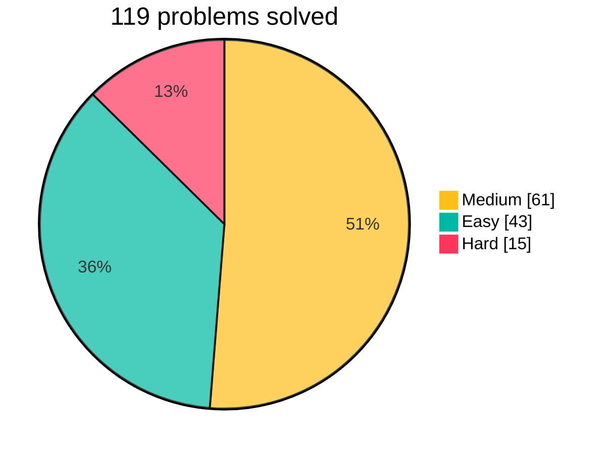

# Leetcode daily

## Solved so far

### From the daily challenge

<b>September 2026</b> · 17 problems

| Day | ID | Title | Level | Files |
| ---: | ---: | --- | --- | --- |
| 4 | 3903 | Smallest Stable Index I | Easy | [notes](./src/3903/readme.md) · [solution](./src/3903/index.py) |
| 9 | 3871 | Count Commas in Range II | Medium | [notes](./src/3871/readme.md) · [solution](./src/3871/index.py) |
| 11 | 3483 | Unique 3-Digit Even Numbers | Easy | [notes](./src/3483/readme.md) · [solution](./src/3483/index.py) |
| 14 | 836 | Rectangle Overlap | Easy | [notes](./src/836/readme.md) · [solution](./src/836/index.py) |
| 17 | 1477 | Find Two Non-overlapping Sub-arrays Each With Target Sum | Medium | [notes](./src/1477/readme.md) · [solution](./src/1477/index.py) |
| 18 | 1520 | Maximum Number of Non-Overlapping Substrings | Hard | [notes](./src/1520/readme.md) · [solution](./src/1520/index.py) |
| 19 | 1401 | Circle and Rectangle Overlapping | Medium | [notes](./src/1401/readme.md) · [solution](./src/1401/index.py) |
| 20 | 3498 | Reverse Degree of a String | Easy | [notes](./src/3498/readme.md) · [solution](./src/3498/index.py) |
| 21 | 3524 | Find X Value of Array I | Medium | [notes](./src/3524/readme.md) · [solution](./src/3524/index.py) |
| 23 | 1658 | Minimum Operations to Reduce X to Zero | Medium | [notes](./src/1658/readme.md) · [solution](./src/1658/index.py) |
| 24 | 3550 | Smallest Index With Digit Sum Equal to Index | Easy | [notes](./src/3550/readme.md) · [solution](./src/3550/index.py) |
| 25 | 1096 | Brace Expansion II | Hard | [notes](./src/1096/readme.md) · [solution](./src/1096/index.py) |
| 26 | 1807 | Evaluate the Bracket Pairs of a String | Medium | [notes](./src/1807/readme.md) · [solution](./src/1807/index.py) |
| 27 | 1190 | Reverse Substrings Between Each Pair of Parentheses | Medium | [notes](./src/1190/readme.md) · [solution](./src/1190/index.py) |
| 28 | 1614 | Maximum Nesting Depth of the Parentheses | Easy | [notes](./src/1614/readme.md) · [solution](./src/1614/index.py) |
| 29 | 2267 | Check if There Is a Valid Parentheses String Path | Hard | [notes](./src/2267/readme.md) · [solution](./src/2267/index.py) |
| 30 | 1111 | Maximum Nesting Depth of Two Valid Parentheses Strings | Medium | [notes](./src/1111/readme.md) · [solution](./src/1111/index.py) |

<b>October 2026</b> · 30 problems

| Day | ID | Title | Level | Files |
| ---: | ---: | --- | --- | --- |
| 1 | 20 | Valid Parentheses | Easy | [notes](./src/20/readme.md) · [solution](./src/20/index.py) |
| 2 | 22 | Generate Parentheses | Medium | [notes](./src/22/readme.md) · [solution](./src/22/index.py) |
| 3 | 32 | Longest Valid Parentheses | Hard | [notes](./src/32/readme.md) · [solution](./src/32/index.py) |
| 4 | 678 | Valid Parenthesis String | Medium | [notes](./src/678/readme.md) · [solution](./src/678/index.py) |
| 5 | 856 | Score of Parentheses | Medium | [notes](./src/856/readme.md) · [solution](./src/856/index.py) |
| 6 | 921 | Minimum Add to Make Parentheses Valid | Medium | [notes](./src/921/readme.md) · [solution](./src/921/index.py) |
| 7 | 301 | Remove Invalid Parentheses | Hard | [notes](./src/301/readme.md) · [solution](./src/301/index.py) |
| 8 | 1021 | Remove Outermost Parentheses | Easy | [notes](./src/1021/readme.md) · [solution](./src/1021/index.py) |
| 9 | 1541 | Minimum Insertions to Balance a Parentheses String | Medium | [notes](./src/1541/readme.md) · [solution](./src/1541/index.py) |
| 10 | 2333 | Minimum Sum of Squared Difference | Medium | [notes](./src/2333/readme.md) · [solution](./src/2333/index.py) |
| 11 | 2778 | Sum of Squares of Special Elements | Easy | [notes](./src/2778/readme.md) · [solution](./src/2778/index.py) |
| 12 | 2897 | Apply Operations on Array to Maximize Sum of Squares | Hard | [notes](./src/2897/readme.md) · [solution](./src/2897/index.py) |
| 13 | 3727 | Maximum Alternating Sum of Squares | Medium | [notes](./src/3727/readme.md) · [solution](./src/3727/index.py) |
| 14 | 3723 | Maximize Sum of Squares of Digits | Medium | [notes](./src/3723/readme.md) · [solution](./src/3723/index.py) |
| 15 | 2913 | Subarrays Distinct Element Sum of Squares I | Easy | [notes](./src/2913/readme.md) · [solution](./src/2913/index.py) |
| 17 | 3551 | Minimum Swaps to Sort by Digit Sum | Medium | [notes](./src/3551/readme.md) · [solution](./src/3551/index.py) |
| 18 | 1569 | Number of Ways to Reorder Array to Get Same BST | Hard | [notes](./src/1569/readme.md) · [solution](./src/1569/index.py) |
| 19 | 2089 | Find Target Indices After Sorting Array | Easy | [notes](./src/2089/readme.md) · [solution](./src/2089/index.py) |
| 20 | 3886 | Sum of Sortable Integers | Hard | [notes](./src/3886/readme.md) · [solution](./src/3886/index.py) |
| 21 | 3863 | Minimum Operations to Sort a String | Medium | [notes](./src/3863/readme.md) · [solution](./src/3863/index.py) |
| 22 | 3942 | Minimum Operations to Sort a Permutation | Medium | [notes](./src/3942/readme.md) · [solution](./src/3942/index.py) |
| 23 | 3644 | Maximum K to Sort a Permutation | Medium | [notes](./src/3644/readme.md) · [solution](./src/3644/index.py) |
| 24 | 2409 | Count Days Spent Together | Easy | [notes](./src/2409/readme.md) · [solution](./src/2409/index.py) |
| 25 | 1254 | Number of Closed Islands | Medium | [notes](./src/1254/readme.md) · [solution](./src/1254/index.py) |
| 26 | 3619 | Count Islands With Total Value Divisible by K | Medium | [notes](./src/3619/readme.md) · [solution](./src/3619/index.py) |
| 27 | 3963 | Create Grid With Exactly One Path | Easy | [notes](./src/3963/readme.md) · [solution](./src/3963/index.py) |
| 28 | 3882 | Minimum XOR Path in a Grid | Medium | [notes](./src/3882/readme.md) · [solution](./src/3882/index.py) |
| 29 | 3841 | Palindromic Path Queries in a Tree | Hard | [notes](./src/3841/readme.md) · [solution](./src/3841/index.py) |
| 30 | 3970 | Shortest Path With At Most K Consecutive Identical Characters | Medium | [notes](./src/3970/readme.md) · [solution](./src/3970/index.py) |
| 31 | 3665 | Twisted Mirror Path Count | Medium | [notes](./src/3665/readme.md) · [solution](./src/3665/index.py) |

#### November 2026

| Day | ID | Title | Level | Files |
| ---: | ---: | --- | --- | --- |
| 1 | 453 | Minimum Moves to Equal Array Elements | Medium | [notes](./src/453/readme.md) · [solution](./src/453/index.py) |
| 2 | 462 | Minimum Moves to Equal Array Elements II | Medium | [notes](./src/462/readme.md) · [solution](./src/462/index.py) |
| 3 | 3736 | Minimum Moves to Equal Array Elements III | Easy | [notes](./src/3736/readme.md) · [solution](./src/3736/index.py) |
| 4 | 3505 | Minimum Operations to Make Elements Within K Subarrays Equal | Hard | [notes](./src/3505/readme.md) · [solution](./src/3505/index.py) |
| 5 | 1385 | Find the Distance Value Between Two Arrays | Easy | [notes](./src/1385/readme.md) · [solution](./src/1385/index.py) |
| 6 | 2747 | Count Zero Request Servers | Medium | [notes](./src/2747/readme.md) · [solution](./src/2747/index.py) |
| 7 | 1882 | Process Tasks Using Servers | Medium | [notes](./src/1882/readme.md) · [solution](./src/1882/index.py) |
| 8 | 1267 | Count Servers that Communicate | Medium | [notes](./src/1267/readme.md) · [solution](./src/1267/index.py) |
| 9 | 1606 | Find Servers That Handled Most Number of Requests | Hard | [notes](./src/1606/readme.md) · [solution](./src/1606/index.py) |
| 10 | 3693 | Climbing Stairs II | Medium | [notes](./src/3693/readme.md) · [solution](./src/3693/main.c) |
| 11 | 3789 | Minimum Cost to Acquire Required Items | Medium | [notes](./src/3789/readme.md) · [solution](./src/3789/index.py) |
| 12 | 3105 | Longest Strictly Increasing or Strictly Decreasing Subarray | Easy | [notes](./src/3105/readme.md) · [solution](./src/3105/main.c) |
| 13 | 3420 | Count Non-Decreasing Subarrays After K Operations | Hard | [notes](./src/3420/readme.md) · [solution](./src/3420/index.py) |
| 14 | 3364 | Minimum Positive Sum Subarray | Easy | [notes](./src/3364/readme.md) · [solution](./src/3364/main.c) |
| 15 | 1524 | Number of Sub-arrays With Odd Sum | Medium | [notes](./src/1524/readme.md) · [solution](./src/1524/index.py) |
| 16 | 2243 | Calculate Digit Sum of a String | Easy | [notes](./src/2243/readme.md) · [solution](./src/2243/index.py) |
| 17 | 2911 | Minimum Changes to Make K Semi-palindromes | Hard | [notes](./src/2911/readme.md) · [solution](./src/2911/index.py) |
| 18 | 2914 | Minimum Number of Changes to Make Binary String Beautiful | Medium | [notes](./src/2914/readme.md) · [solution](./src/2914/main.c) |
| 19 | 2567 | Minimum Score by Changing Two Elements | Medium | [notes](./src/2567/readme.md) · [solution](./src/2567/index.py) |
| 20 | 3041 | Maximize Consecutive Elements in an Array After Modification | Hard | [notes](./src/3041/readme.md) · [solution](./src/3041/main.c) |

### From the problem list

| ID | Title | Level | Files |
| ---: | --- | --- | --- |
| 1 | Two Sum | Easy | [notes](./src/1/readme.md) · [solution](./src/1/index.py) |
| 2 | Add Two Numbers | Medium | [notes](./src/2/readme.md) · [solution](./src/2/index.py) |
| 3 | Longest Substring Without Repeating Characters | Medium | [notes](./src/3/readme.md) · [solution](./src/3/index.py) |
| 5 | Longest Palindromic Substring | Medium | [notes](./src/5/readme.md) · [solution](./src/5/index.py) |
| 6 | Zigzag Conversion | Medium | [notes](./src/6/readme.md) · [solution](./src/6/index.py) |
| 7 | Reverse Integer | Medium | [notes](./src/7/readme.md) · [solution](./src/7/index.py) |
| 8 | String to Integer (atoi) | Medium | [notes](./src/8/readme.md) · [solution](./src/8/index.py) |
| 10 | Regular Expression Matching | Hard | [notes](./src/10/readme.md) · [solution](./src/10/index.py) |
| 12 | Integer to Roman | Medium | [notes](./src/12/readme.md) · [solution](./src/12/index.py) |
| 13 | Roman to Integer | Easy | [notes](./src/13/readme.md) · [solution](./src/13/index.py) |
| 14 | Longest Common Prefix | Easy | [notes](./src/14/readme.md) · [solution](./src/14/index.py) |
| 15 | 3Sum | Medium | [notes](./src/15/readme.md) · [solution](./src/15/index.py) |
| 1619 | Mean of Array After Removing Some Elements | Easy | [notes](./src/1619/readme.md) · [solution](./src/1619/main.c) |
| 1963 | Minimum Number of Swaps to Make the String Balanced | Medium | [notes](./src/1963/readme.md) · [solution](./src/1963/index.py) |

### From contests

| ID | Title | Level | Contest | Files |
| ---: | --- | --- | --- | --- |
| 4056 | Number of Intersecting Interval Pairs I | Easy | [Weekly 520](https://leetcode.com/contest/weekly-contest-520/) Q1 | [notes](./src/4056/readme.md) · [solution](./src/4056/index.py) |
| 4057 | Number of Intersecting Interval Pairs II | Medium | [Weekly 520](https://leetcode.com/contest/weekly-contest-520/) Q2 | [notes](./src/4057/readme.md) · [solution](./src/4057/index.py) |
| 4058 | Maximum Pulse Value After One Subarray Rotation | Medium | [Weekly 520](https://leetcode.com/contest/weekly-contest-520/) Q3 | [notes](./src/4058/readme.md) · [solution](./src/4058/index.py) |
| 4065 | Rearrange Array by Removing Distinct Values | Easy | [Weekly 521](https://leetcode.com/contest/weekly-contest-521/) Q1 | [notes](./src/4065/readme.md) · [solution](./src/4065/index.py) |
| 4066 | Maximum Equal Adjacent Pairs After at Most One Replacement | Medium | [Weekly 521](https://leetcode.com/contest/weekly-contest-521/) Q2 | [notes](./src/4066/readme.md) · [solution](./src/4066/index.py) |
| 4070 | Minimum Rotations to Dial a Number I | Easy | [Weekly 522](https://leetcode.com/contest/weekly-contest-522/) Q1 | [notes](./src/4070/readme.md) · [solution](./src/4070/index.py) |
| 4071 | Minimum Rotations to Dial a Number II | Medium | [Weekly 522](https://leetcode.com/contest/weekly-contest-522/) Q2 | [notes](./src/4071/readme.md) · [solution](./src/4071/index.py) |
| 4078 | Three Fibonacci Sum | Easy | [Weekly 523](https://leetcode.com/contest/weekly-contest-523/) Q1 | [notes](./src/4078/readme.md) · [solution](./src/4078/index.py) |
| 4079 | Prime Subset Selection I | Medium | [Weekly 523](https://leetcode.com/contest/weekly-contest-523/) Q2 | [notes](./src/4079/readme.md) · [solution](./src/4079/index.py) |
| 4080 | Design Bus Seat Booking System | Medium | [Weekly 523](https://leetcode.com/contest/weekly-contest-523/) Q3 | [notes](./src/4080/readme.md) · [solution](./src/4080/index.py) |
| 4074 | Maximum Product Pair With Target Sum | Easy | [Biweekly 193](https://leetcode.com/contest/biweekly-contest-193/) Q1 | [notes](./src/4074/readme.md) · [solution](./src/4074/index.py) |
| 4075 | Longest Resilient Subarray I | Medium | [Biweekly 193](https://leetcode.com/contest/biweekly-contest-193/) Q2 | [notes](./src/4075/readme.md) · [solution](./src/4075/index.py) |
| 4076 | Longest Resilient Subarray II | Medium | [Biweekly 193](https://leetcode.com/contest/biweekly-contest-193/) Q3 | [notes](./src/4076/readme.md) · [solution](./src/4076/index.py) |
| 4083 | Minimum Deletions to Make Array Sharp | Easy | [Weekly 524](https://leetcode.com/contest/weekly-contest-524/) Q1 | [notes](./src/4083/readme.md) · [solution](./src/4083/index.py) |
| 4084 | Last Visited Cell in a Directional Grid | Medium | [Weekly 524](https://leetcode.com/contest/weekly-contest-524/) Q2 | [notes](./src/4084/readme.md) · [solution](./src/4084/index.py) |
| 4085 | Find Root of a Colored Tree | Medium | [Weekly 524](https://leetcode.com/contest/weekly-contest-524/) Q3 | [notes](./src/4085/readme.md) · [solution](./src/4085/index.py) |
| 4088 | Difference Between Peaks and Valleys | Easy | [Biweekly 194](https://leetcode.com/contest/biweekly-contest-194/) Q1 | [notes](./src/4088/readme.md) · [solution](./src/4088/index.py) |
| 4089 | Count Subarrays With Loose Bounds | Medium | [Biweekly 194](https://leetcode.com/contest/biweekly-contest-194/) Q2 | [notes](./src/4089/readme.md) · [solution](./src/4089/index.py) |
| 4092 | Binary Digit Score | Easy | [Weekly 525](https://leetcode.com/contest/weekly-contest-525/) Q1 | [notes](./src/4092/readme.md) · [solution](./src/4092/index.py) |
| 4093 | Maximize Sum After At Most K Digit Rearrangements | Medium | [Weekly 525](https://leetcode.com/contest/weekly-contest-525/) Q2 | [notes](./src/4093/readme.md) · [solution](./src/4093/index.py) |
| 4097 | Minimum Value of Merged Integers | Easy | [Weekly 526](https://leetcode.com/contest/weekly-contest-526/) Q1 | [notes](./src/4097/readme.md) · [solution](./src/4097/index.py) |
| 4106 | Find Mismatched Segments Between Two Strings | Medium | [Weekly 527](https://leetcode.com/contest/weekly-contest-527/) Q1 | [notes](./src/4106/readme.md) · [solution](./src/4106/index.py) |
| 4111 | Count Consistent Subarrays I | Easy | [Weekly 528](https://leetcode.com/contest/weekly-contest-528/) Q1 | [notes](./src/4111/readme.md) · [solution](./src/4111/main.c) |

### From quests

| ID | Title | Level | Quest | Files |
| ---: | --- | --- | --- | --- |
| 1929 | Concatenation of Array | Easy | Data Structures & Algorithms > Array I | [notes](./src/1929/readme.md) · [solution](./src/1929/index.py) |
| 1470 | Shuffle the Array | Easy | Data Structures & Algorithms > Array I | [notes](./src/1470/readme.md) · [solution](./src/1470/index.py) |
| 485 | Max Consecutive Ones | Easy | Data Structures & Algorithms > Array I | [notes](./src/485/readme.md) · [solution](./src/485/index.py) |
| 645 | Set Mismatch | Easy | Data Structures & Algorithms > Array II | [notes](./src/645/readme.md) · [solution](./src/645/index.py) |
| 1365 | How Many Numbers Are Smaller Than the Current Number | Easy | Data Structures & Algorithms > Array II | [notes](./src/1365/readme.md) · [solution](./src/1365/index.py) |
| 448 | Find All Numbers Disappeared in an Array | Easy | Data Structures & Algorithms > Array II | [notes](./src/448/readme.md) · [solution](./src/448/index.py) |
| 150 | Evaluate Reverse Polish Notation | Medium | Data Structures & Algorithms > Stack | [notes](./src/150/readme.md) · [solution](./src/150/index.py) |
| 1441 | Build an Array With Stack Operations | Medium | Data Structures & Algorithms > Stack | [notes](./src/1441/readme.md) · [solution](./src/1441/index.py) |
| 9 | Palindrome Number | Easy | Maths > Arithmetic & Basic Reasoning | [notes](./src/9/readme.md) · [solution](./src/9/index.py) |
| 2485 | Find the Pivot Integer | Easy | Maths > Arithmetic & Basic Reasoning | [notes](./src/2485/readme.md) · [solution](./src/2485/index.py) |
| 1502 | Can Make Arithmetic Progression From Sequence | Easy | Maths > Arithmetic & Basic Reasoning | [notes](./src/1502/readme.md) · [solution](./src/1502/index.py) |
| 263 | Ugly Number | Easy | Maths > Divisibility & Modular Arithmetic | [notes](./src/263/readme.md) · [solution](./src/263/index.py) |
| 636 | Exclusive Time of Functions | Medium | Data Structures & Algorithms > Stack | [notes](./src/636/readme.md) · [solution](./src/636/index.py) |
| 739 | Daily Temperatures | Medium | Data Structures & Algorithms > Monotonic Stack | [notes](./src/739/readme.md) · [solution](./src/739/index.py) |
| 1475 | Final Prices With a Special Discount in a Shop | Easy | Data Structures & Algorithms > Monotonic Stack | [notes](./src/1475/readme.md) · [solution](./src/1475/index.py) |

## Stats

<!-- stats:start -->

<!-- stats:end -->

## AI use disclaimer

> [!IMPORTANT]
> Every solution in this repo is my own. AI is used around the solutions, never to write them.

This project has a few agents with clear limits:
- **Solution feedback**: only runs after I already have an accepted solution. It discusses complexity, style, alternative approaches and edge cases as ideas only, and never gives me code.
- **Grammar review**: proofreads the English in my notes without changing the code or my technical meaning.
- **Animations**: helps build the interactive p5.js visualizations of some solutions.
- **Scaffolding**: creates the folder for a new problem from the template and adds its row to these tables.
